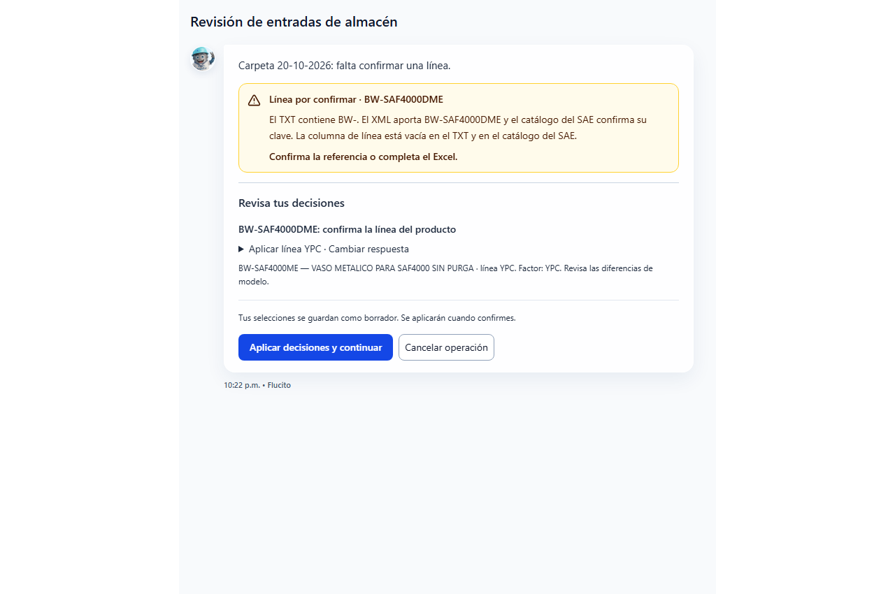
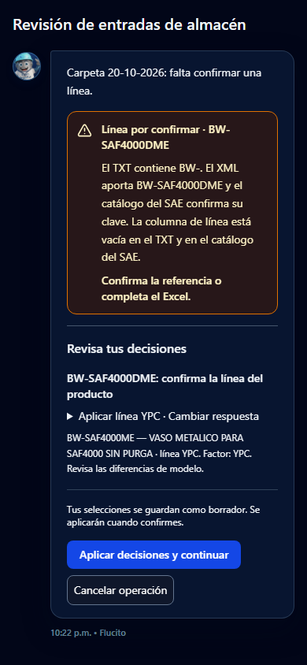
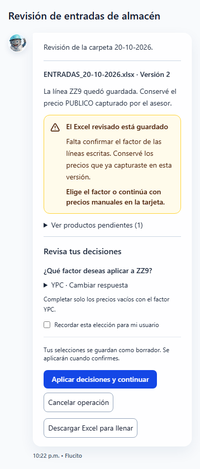
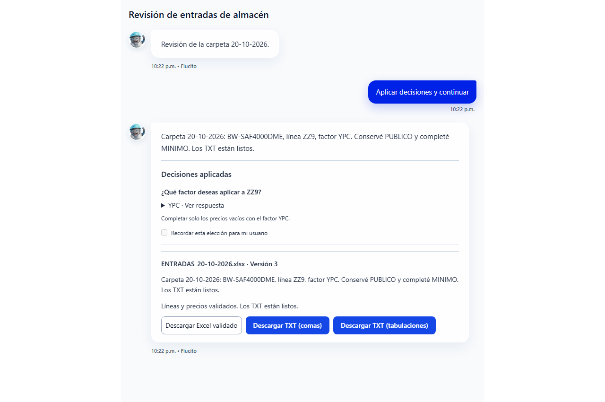

# Líneas pendientes y revisión del Excel

## Alcance acordado

Entrega local para revisión de los asesores. No incluye moneda ni consulta a SAE en producción. Se admiten códigos de línea escritos por el asesor aunque no existan en la copia disponible. Las sugerencias necesitan confirmación; recordar un factor requiere elección expresa.

## Fase 1: fuentes y explicaciones

Cada producto conserva clave de apoyo, clave XML, coincidencia en el catálogo del SAE y procedencia de línea. Se distingue apoyo ausente, lectura fallida, partida no emparejada y columna de línea vacía. La explicación se conserva en los comentarios de clave y línea del Excel y en el resumen del reporte. Las inferencias de una línea única dentro del apoyo conservan el valor original vacío.

Validación inicial: 16 pruebas aprobadas (procedencia general, `BW-SAF4000DME`, otra clave sintética, apoyo ilegible, resumen del chat y pipeline).

## Secuencia de entrega

2. Sugerencias conservadoras por familia de código, SAT y unidad; decisión por producto y trazabilidad de referencia.
3. Corrección de líneas pendientes y precios en Excel, con persistencia de la versión revisada mientras se elige factor.
4. Avisos ámbar accesibles, resumen de decisiones, continuidad en el chat y descargas verificadas.
5. Regresiones, revisión visual y reproceso aislado de las 44 carpetas locales; resultados y capturas al final de este archivo.

## Fase 2: sugerencias confirmadas

Se muestran hasta tres referencias en total, agrupadas por línea, exigiendo familia de código, secuencia de medidas, clave SAT y unidad SAT iguales. Las diferencias de sufijo/modelo se muestran mediante la clave y descripción completas. No se equiparan fracciones con enteros. Sin referencia fiable se ofrece completar el Excel. La elección registra referencia y confirmación; una referencia que cambió se rechaza. La línea vacía bloquea ambos TXT y deja únicamente los cinco precios de venta vacíos, conservando compra.

Validación: 32 pruebas aprobadas de decisiones, catálogo y líneas. Se consultó el esquema de la copia reciente de Firebird en transacción de solo lectura: `INVE02.LIN_PROD` y `CLIN02.CVE_LIN` tienen longitud 5. Los códigos manuales se validan con ese límite.

## Fase 3: Excel corregido y factores

Solo las filas originalmente pendientes admiten cambio de línea. Se normalizan espacios exteriores y mayúsculas; los códigos admitidos son de 1 a 5 caracteres ASCII alfanuméricos, guion y guion bajo. No se exige que existan en la copia del catálogo ni se expanden por parecido a otra línea. Se conserva compra; los precios manuales positivos y finitos se respetan y únicamente los vacíos se calculan.

Sin factor, se guarda una nueva versión del Excel recibido y se abre la tarjeta de factores existente. La confirmación reanuda esa copia persistida; elegir precios manuales conserva los pendientes y permite descargar esa versión para terminarla. Una versión anterior o una confirmación repetida se rechazan. Las preferencias de factor se consultan por código exacto y únicamente se guardan con la casilla expresa del usuario. La línea confirmada no crea altas en SAE.

Validación de esta fase: 30 pruebas aprobadas, incluidas líneas YPC con cero, dos o cinco precios manuales; líneas DAYCO sin factor y ZZ9 ausente del catálogo; reanudación; precios manuales y rechazo de formatos incompatibles.

## Fase 4: estado visible y continuidad

Se aplicó la guía local `emil-design-eng`: avisos ámbar con icono, título, explicación y acción; contraste en claro y oscuro; controles nativos por teclado y foco visible. Los errores bloqueantes conservan rojo. No se añadieron animaciones a estas decisiones frecuentes. Los avisos estructurados viajan en la respuesta y se guardan en el historial.

| Antes | Después |
| --- | --- |
| Línea ausente dentro del texto general | Aviso ámbar con fuentes y acción explícita |
| Subida centrada solo en precios | Revisión de líneas, precios manuales y factor |
| Excel subido sin estado intermedio visible | Versión guardada y tarjeta de factor recuperable al recargar |
| Tarjetas repetidas al continuar | Solo la tarjeta vigente de cada reporte; texto histórico conservado |

La confirmación de un factor de revisión continúa sin llamar al modelo ni reprocesar los documentos. El chat y su memoria registran el nombre del reporte, la línea, el factor y los precios completados o conservados. Las descargas de ambos TXT permanecen bloqueadas durante los pendientes.

## Fase 5: resultados finales

Fecha de entrega local: 23 de noviembre de 2026. Comparación contra el commit anterior `dd87b2b` utilizando una exportación temporal de su código y otra ejecución del código nuevo. Se copiaron únicamente documentos fuente; las ejecuciones no usaron Drive ni modelos. Los hashes SHA-256 de todos los XML, TXT y PDF fuente se comprobaron antes y después.

| Verificación | Resultado |
| --- | --- |
| Carpetas de proveedores reprocesadas | 44 |
| XML procesados | 72 |
| Filas resultantes por XML, tras deduplicación | 404 |
| Errores de extracción | 0 |
| Cambios inesperados en claves, líneas, compra o venta | 0 |
| Cambios esperados en venta | 43 filas: de ceros sin línea a campos vacíos pendientes |
| Productos pendientes por carpeta | 43, distribuidos en 14 carpetas |
| Pendientes sin apoyo correspondiente | 42 |
| Pendiente con columna de línea vacía en TXT | 1: `BW-SAF4000DME` |
| Productos con referencias suficientemente cercanas | 2 |
| Documentos fuente modificados | 0 |
| Backend | 219 pruebas aprobadas, 1 omitida |
| Interfaz con Playwright | 28 pruebas aprobadas en escritorio y móvil emulado |
| Compilación de producción del frontend | Correcta |

La prueba omitida es una regresión antigua de restauración que busca una copia local específica del 17 de noviembre en otra ruta. Esta entrega sí ejecutó el reproceso de las 44 carpetas disponibles. La compilación conserva el aviso no bloqueante de un paquete JavaScript superior a 500 kB.

Los dos productos con sugerencias son `BW-SAF4000DME` y `YSIDB50-160-EI`. No se asignó una línea automáticamente a los otros 41 productos. La búsqueda es deliberadamente conservadora: exige los mismos componentes numéricos de modelo/medida, SAT y unidad; no elimina fracciones ni sufijos visibles de las referencias.

### Caso real YPC

El TXT aporta `BW-`, el XML aporta `BW-SAF4000DME` y el catálogo del SAE confirma esa clave. La columna de línea está vacía en el TXT y también en ese registro del catálogo. Se muestra como referencia más cercana `BW-SAF4000ME`, **vaso metálico sin purga**, línea YPC; el artículo solicitado es **con purga automática**. Esa diferencia permanece visible y exige confirmación.

Una confirmación simulada únicamente en la copia de prueba aplicó línea YPC y factor YPC, conservó compra **443.716** y calculó PUBLICO **739.5267**. La referencia y la confirmación quedaron en la trazabilidad. El ensayo no representa una decisión del asesor ni modifica SAE o Drive.

### Regresiones adicionales

Se verificaron claves truncadas con XML y catálogo, otro código sintético, apoyo ilegible, sugerencias con varias líneas, ausencia de referencias y diferencias de medida/SAT/unidad. Se probaron líneas existentes con factor, existentes sin factor y nuevas para la copia; precios vacíos, parcialmente capturados y totalmente manuales; identidad, columnas, filas, precios inválidos y versiones anteriores. Una confirmación repetida se rechaza y la memoria del chat conserva producto, línea y factor aplicados.

Se verificó además la corrección parcial del consolidado al revisar un proveedor: conserva los otros productos pendientes e incrementa la versión. Un error al confirmar un factor conserva el Excel revisado y presenta un aviso rojo con una nueva confirmación explícita; no repite la operación automáticamente. Una revisión que ya espera factor mantiene su versión independiente.

### Capturas

Las capturas usan un escenario de prueba controlado; `ZZ9` sirve como línea ausente del catálogo disponible. Cubren escritorio 1280 × 850, móvil emulado 390 × 844, teclado y temas claro y oscuro.









### Reproducción

Desde la raíz del proyecto, usar el entorno local `FlucitoEnv`:

```powershell
FlucitoEnv\Scripts\python.exe backend/evaluations/verificar_lineas_revision.py --fuente "RUTA_A_DOCUMENTOS_ENTRADA\2026" --salida backend/datos/laboratorio_sae/revision_lineas.json
```

La evidencia detallada queda localmente en `backend/datos/laboratorio_sae/revision_lineas.json` (ignorada por Git para conservar privados los documentos y datos comerciales). Incluye todas las filas comparadas, las diferencias y las sugerencias por carpeta. El script sale con error si cambia una clave, línea o costo; si aparece cualquier otro cambio de venta fuera de los vacíos esperados; si falla una extracción; o si cambia una fuente.

### Prueba recomendada para el asesor

1. Generar el reporte de la carpeta de YPC y revisar la explicación de `BW-SAF4000DME` y sus referencias. Elegir aplicar YPC o completar el Excel.
2. Si se elige Excel, escribir una línea válida, conservar compra y capturar opcionalmente algunos precios de venta. Adjuntar el archivo desde la tarjeta.
3. Confirmar el factor si falta; comprobar que los precios escritos se conservaron y solo se calcularon los vacíos. Recargar antes de confirmar para comprobar la continuidad.
4. Descargar el Excel validado y ambos TXT. Revisar comentarios y formato de importación antes de preparar las altas en SAE.

No se hizo una importación real en SAE ni una actualización en Drive de producción. La entrega comprende cinco commits locales para revisión antes del envío al servidor. Las pruebas de interfaz usan respuestas controladas y las de API ejecutan el validador real con servicios externos simulados.
